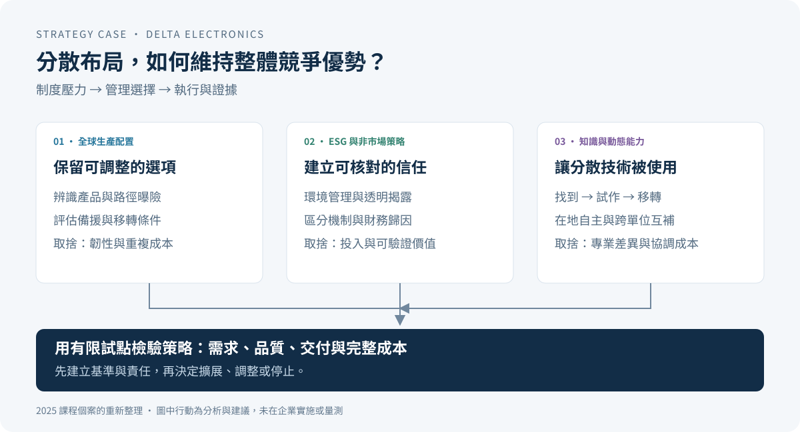

# 台達電：地緣政治風險下的跨國策略與知識整合

### 從關稅衝擊、非市場策略，到企業知識的跨國運用

[English](README.en.md) · [完整個案](docs/case-study.zh-TW.md) · [理論與實務](docs/theory-to-practice.zh-TW.md) · [策略執行方案](docs/strategy-playbook.zh-TW.md) · [個人與團隊貢獻](docs/contribution.md)

**當生產據點搬到更多國家，企業如何同時降低政策曝險、保留技術優勢，並避免組織變得更難協調？**

本專案整理國立成功大學 Business Policy and Strategy 課程的 2025 年台達電個案，以及李奕成（Eason Lee）的個人文獻簡報。分析將國際企業理論、ESG 非市場策略、知識基礎觀點與動態能力連結到全球生產布局與跨單位協作。

> **核心判斷：** 產地多元化提供調整空間；當地應變能力與跨國知識整合，決定這些空間能否轉化為競爭優勢。ESG 可作為建立信任與降低資訊不對稱的機制，但企業營收成長本身不足以證明 ESG 抵銷了關稅衝擊。

## 個案分析的三條主線

| 經營問題 | 理論如何幫助判斷 | 對應的管理決策 |
|---|---|---|
| 關稅與制度要求不斷變化，是否應全面搬遷？ | 以制度壓力的特定性與破壞性區分情境；結合企業能動性與多層次利害關係人分析 | 按產品、供應鏈與市場評估布局，保留替代產能與調整節點 |
| ESG 能否產生實際經營價值？ | 將聲譽、在地正當性與資訊不對稱視為可能機制 | 以新據點的環境績效、合規資料及可追溯揭露建立信任，再檢驗效果 |
| 海外據點與子公司增加後，如何創造綜效？ | 知識資產互補性、技術關聯性、sensing／seizing／reconfiguring | 保留當地決策權，同時建立技術索引、協作窗口、共同試作與知識移轉 |

## 理論如何變成可執行的建議

例如：若區域團隊發現客戶需要不同的電源或散熱配置，**sensing** 應留下需求與可用技術的對照；**seizing** 要有跨單位的負責人、預算與試作決策；**reconfiguring** 則須把有效設計轉成可移轉的文件、培訓與製程。各階段均應追蹤時間、採用率與品質，才能判斷知識是否被實際使用。

這是本次整理提出的執行設計，尚未在台達電實施。完整方案見 [策略執行與衡量](docs/strategy-playbook.zh-TW.md)。

## 本作品呈現的分析能力

| 能力 | 可直接閱讀的成果 |
|---|---|
| 問題定義與策略整合 | [個案分析](docs/case-study.zh-TW.md)：從外部制度壓力連到內部能力與組織取捨 |
| 文獻閱讀與研究判讀 | [研究審閱](docs/research-review.zh-TW.md)：HLM、交互作用、模型差異及外推限制 |
| 理論與企業實務連結 | [理論對照](docs/theory-to-practice.zh-TW.md)：每個概念對應決策、觀察指標與限制 |
| 策略落地與管理溝通 | [執行方案](docs/strategy-playbook.zh-TW.md)：行動、責任角色、推進條件與停止條件 |
| 證據品質與批判思考 | [原稿審閱](docs/evidence-review.md)：核對係數、比例衝突與因果推論 |

## 證據與作品歸屬

- **團隊成果：** 27 頁期末報告與 46 頁簡報共同分析台達電；Eason 列名共同作者，來源未記錄逐節分工。
- **個人成果：** 10 頁署名簡報整理知識資產互補性與動態能力研究；附帶的 35 頁 PDF 是 Aliyev 與 Lee 的期刊原文，研究及資料屬原作者。
- **本次整理：** 重新撰寫案例、核對文獻表格、繪製分析圖、補充策略執行與驗證設計。

原始 PDF、Keynote、學號、電子郵件與完整團隊名單保留於本機；公開庫提供重寫分析、來源頁碼與選定研究數值。此作品以 **2025 年課程情境**為主，2026 年整理核對不構成最新關稅或企業部署更新。未取得企業內部成本、專案及產能資料，未進行台達電實證研究或建議成效量測。[來源](docs/sources.md) · [使用與歸屬](NOTICE.md)

## 閱讀路線

1. [完整個案分析](docs/case-study.zh-TW.md)：經營問題、環境與能力、選項、取捨及建議。
2. [理論與實務對照](docs/theory-to-practice.zh-TW.md)：由概念推導可檢驗的管理問題。
3. [策略執行方案](docs/strategy-playbook.zh-TW.md)：分階段行動與衡量定義。
4. [文獻方法與結果審閱](docs/research-review.zh-TW.md)：區分研究發現與案例應用。
5. [原稿證據審閱](docs/evidence-review.md)、[貢獻說明](docs/contribution.md)、[來源與頁碼](docs/sources.md)。

執行 `python3 scripts/verify_portfolio.py` 可檢查內部連結、公開資料邊界與研究數值的一致性；此檢查不重跑原研究，也不驗證策略成效。
