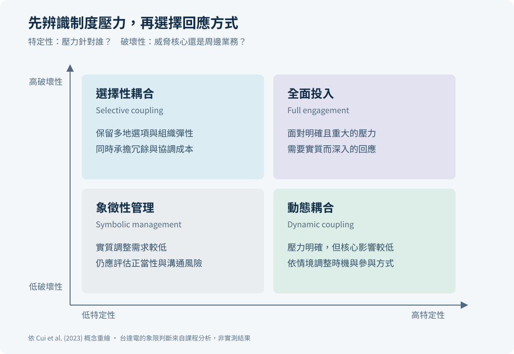

# 理論如何連到實務決策

[回首頁](../README.md) · [個案](case-study.zh-TW.md)

框架的價值在於改變問題的問法，並指出需要哪些證據。本表區分原課程採用的理論與本次整理提出的觀察方式；指標與行動皆為建議，沒有企業執行紀錄。

| 理論或概念 | 要解釋的機制 | 台達電個案的應用 | 建議觀察或行動 | 限制 |
|---|---|---|---|---|
| IPE／Open Economy Politics | 企業利益與制度如何影響政策互動 | 將貿易壓力拆成企業、產業、政府層級 | 建立利害關係人與政策情境表 | 概念不能替代對特定政策的實際調查 |
| MNC agency、行動者多樣性、多層次分析 | 跨國企業可透過不同關係回應環境 | 同時考慮產業團體、客戶、地方與中央政府 | 設定資訊交換、協調與升級窗口 | 外國企業的接觸權與影響力有限；未證實個案遊說活動 |
| Specificity × destructiveness | 制度壓力針對誰、威脅多深，影響回應方式 | 分辨全面衝擊與特定市場／產品壓力 | 逐路徑評估後選擇保留、備援或調整 | 原小組的「低特定性、高破壞性」是判斷，未量化 |
| ESG 非市場策略 | 在地信任與正當性可能影響企業面對政治緊張的處境 | 將廠區管理與揭露連到利害關係人需求 | 把績效、改善、責任人與資料範圍一起揭露 | 營收成長無法識別 ESG 的獨立效果 |
| 外國機構投資人與環境績效 | 所有權與跨國情境可能影響企業環境作為 | 對新據點提供更清楚的環境與合規資訊 | 追蹤資料完整度、投資人提問與議題關閉 | 原稿已指出研究產業與台達電不同；不直接推論撤資 |
| Knowledge-based view | 知識的積累與可運用性影響優勢 | 盤點可重用的電源、散熱、控制與系統知識 | 建立技術索引、能力窗口及使用條件 | 專利數不能完整代表知識品質與隱性經驗 |
| 知識互補性 | 自身與其他單位知識的組合可能創造額外價值 | 在一項產品或流程中檢驗跨單位技術組合 | 比較組合前後的功能、品質、時間與成本 | 技術並存或相關並不等於互補已發生 |
| 技術關聯性與知識分散 | 相關知識提供理解基礎，分散提供專業差異 | 保留各單位專長，找出可整合介面 | 以試作驗證相容性，定義介面與責任 | 過度標準化可能限制在地創新；分散也增加協調成本 |
| Sensing | 找到可用的知識與市場機會 | 連結區域需求與內部技術來源 | 記錄搜尋時間、候選技術、需求驗證 | 個人簡報的「更早察覺」不能當成台達電實測結果 |
| Seizing | 選擇並投入資源使用機會 | 為跨單位方案指定預算、負責人及試作 | 追蹤評估到立項時間、採用與未採用原因 | 原研究採專利引用代理變數，與管理指標不同 |
| Reconfiguring | 調整資源與運作方式以支持新用途 | 把有效試作轉成可移轉的製程與設計 | 培訓、交接、版本與品質確認 | 個案應用不是原研究另行估計的 H6 |
| 在地／非在地綁定的 FSA | 有些能力依賴地點，另一些可跨國使用 | 分開處理在地客戶經驗與可共享技術 | 明列當地決策權及全球共用項目 | 可移轉性需實際驗證；搬廠不等於能力移轉 |

## 四象限框架的正確使用

此圖依 Cui 等人（2023）概念重繪；[來源與全文](https://pmc.ncbi.nlm.nih.gov/articles/PMC9942019/)。企業可隨產品、地點與時點而落在不同情境，應定期重評。圖中分類是理論回應類型，並非對台達電現況的評分。

## 用一個情境串起理論

**假設情境：** 某地客戶要求調整系統配置，同時既有供應路徑的政策不確定性增加。

1. 先區分壓力對該產品與路徑的影響，避免從宏觀新聞直接推導全面搬遷。
2. 區域團隊確認客戶需求與限制，技術窗口搜尋其他單位可用的模組與經驗。
3. 以共同試作確認相容性，並記錄追加協調成本與品質問題。
4. 若試作達到預先定義的標準，再把文件、培訓與設計版本移轉至執行據點。
5. 比較導入前後的交付與品質，保留失敗或未採用原因，以供下一次決策。

此例為本次整理的管理情境，不是台達電已發生的專案。理論來源與課程頁碼見 [來源表](sources.md)。
